# E-Commerce Analytics | End-to-End SQL Business Analysis

## Overview

This project performs a comprehensive **end-to-end analysis of an e-commerce business** using **MySQL** and **Python**, replicating real-world analytical workflows used by Data Analysts in technology companies.

The dataset contains realistic transactional, behavioral, and marketing data, enabling deep analysis across:

- Traffic acquisition
- Website performance
- Conversion funnel optimization
- Marketing channel performance
- Product performance
- User retention
- Business growth and seasonality

---

## Information

- **Targeted Conversion Rate:** 4%
- **Cost Per Conversion:** 2

**Sales funnel**
/home → /products → /(product-name) → /cart → /shipping → /billing → /thanks

**4-product launch period**

- mrfuzzy
- lovebear
- birthday panda
- mini-bear

The goal is to answer stakeholder questions and generate insights to support **marketing, product, and executive decision-making**.

---

# Dataset Structure

- **website_sessions** — traffic source, device, and session information (500k+ rows)
- **website_pageviews** — user navigation behavior (1.3M+ rows)
- **orders** — transaction records
- **order_items** — product-level purchase details
- **order_items_refund** — product-level return details

---

# 1. Traffic Analysis & Optimization

## Top Traffic Sources

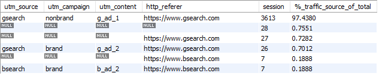

The **gsearch / nonbrand** campaign contributes **97.4% of total traffic**, indicating it is the most significant acquisition source.

---

## Conversion Rates by Top Traffic Source

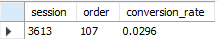

The conversion rate of **gsearch / nonbrand** is **2.96%**, which is below the **target 4%**.

---

## Conversion Rate, CPA & CPC by Device

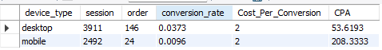

Breaking gsearch / nonbrand performance down by device shows a large gap:

| Device | Conversion rate | CPA (cost per order) |
|---|---|---|
| Desktop | **3.73%** | **$53.62** |
| Mobile | 0.96% | $208.33 |

Desktop acquires an order at roughly **1/4 of the mobile cost**. Reallocating bid budget toward **desktop traffic** should improve marketing efficiency.

---

## Traffic Analysis for Bid Launch

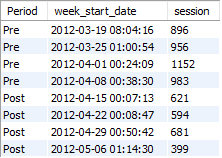

Because gsearch / nonbrand converted below the **4%** threshold, the campaign was **bid down on 2012-04-15**. Weekly session volume fell by about **42.5%**, showing the campaign is highly sensitive to bid changes.

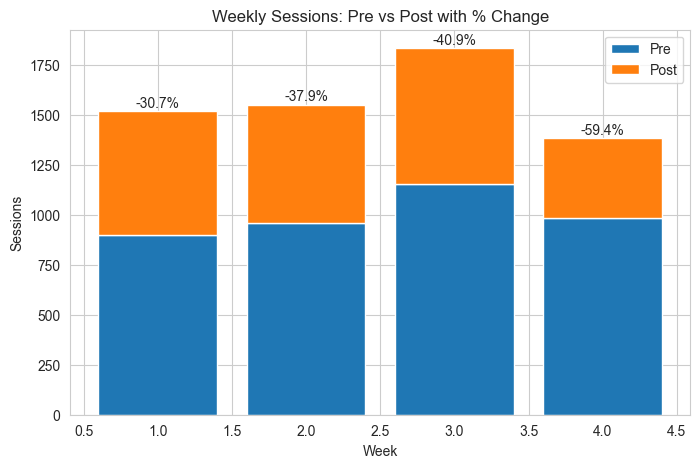

The visualization compares **before bid launch (Pre)** and **after bid launch (Post)**.

---

# 2. Website Measurement & Testing

## Most Visited Pages

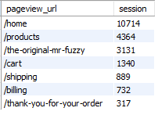

The first three pages capture the majority of sessions. Most users enter through **/home**.

---

## Bounce Rate Analysis

The homepage shows a **59.18% bounce rate**, which is considered high.  
A **new landing page test** was proposed.

---

## Landing Page Test Results

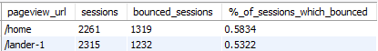

The experiment resulted in a **5.12% improvement in bounce rate**.

---

## Landing Page Trend

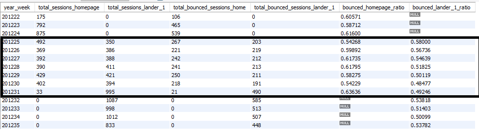

A noticeable traffic shift occurred after launching the new homepage.

Stable analysis period: **Week 25–30**

Bounce rate improved from:

**58.16% → 53.14% (≈5% improvement)**

---

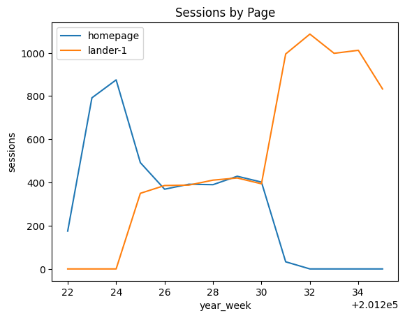

Traffic shift after homepage launch.

---

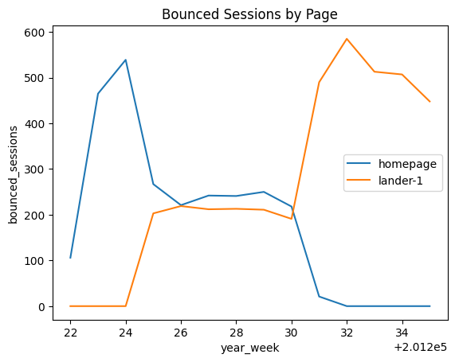

Bounced session trend.

---

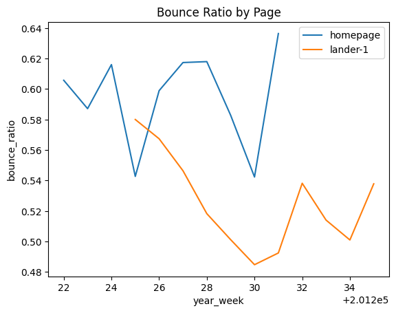

Bounce rate improvement after launch.

---

## Conversion Funnel

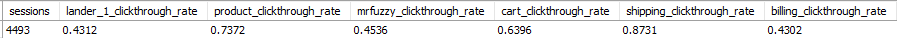

The **billing page** has the lowest conversion rate (**43.02%**), so a new page **billing-2** was introduced.

---

## Funnel Test Comparison

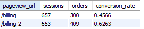

After a **2-month experiment**, conversion improved from:

**45.66% → 62.63%**

---

# 3. Channel Analysis & Optimization

## Channel Portfolio Trend by Traffic

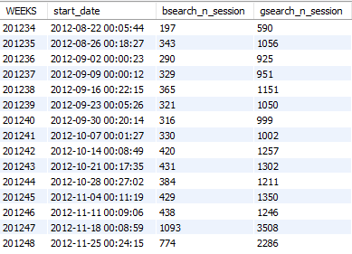

Weekly sessions from **week 34 to week 48**, with a major spike in **week 47 (Black Friday)**.

---

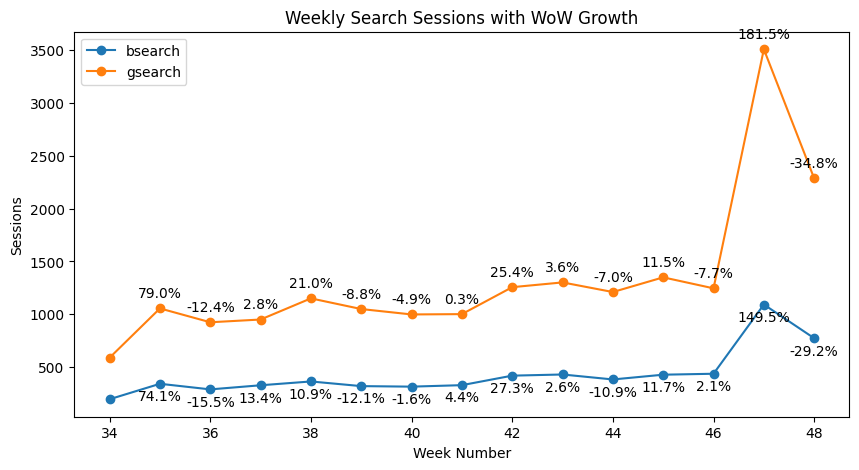

Trend and **week-over-week (WoW)** comparison of the two main channels.

---

## Channel Analysis by Mobile Device

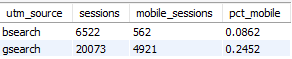

Mobile share:

- **gsearch:** 24.52%
- **bsearch:** 8.62%

---

## Channel Analysis by Device Type

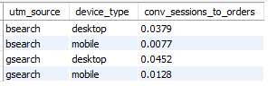

Overall, **gsearch outperforms bsearch**, leading to a slight **bid down on bsearch**.

---

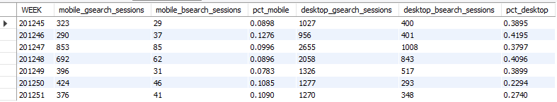

After the bid down, **bsearch sessions decreased slightly**.

---

## Channel Portfolio Growth

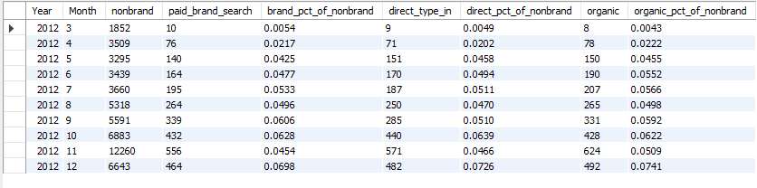

Traffic growth appears not only in **nonbrand**, but also in:

- brand
- direct
- indirect

---

# 4. Business Patterns & Seasonality

## Business Performance Overview

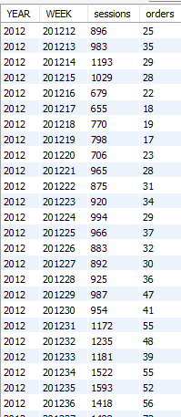

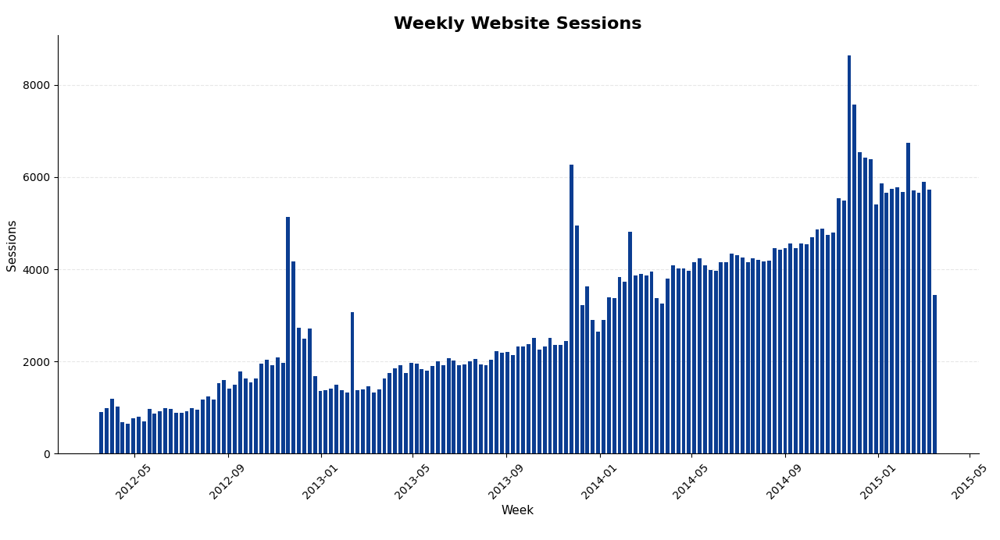

Year-over-year growth is consistent.

Major spikes appear during:

- **Black Friday**
- **Cyber Monday**

**Growth**

- Sessions ↑ **93.75%**
- Orders ↑ **157.19%**

---

## Correlation Analysis

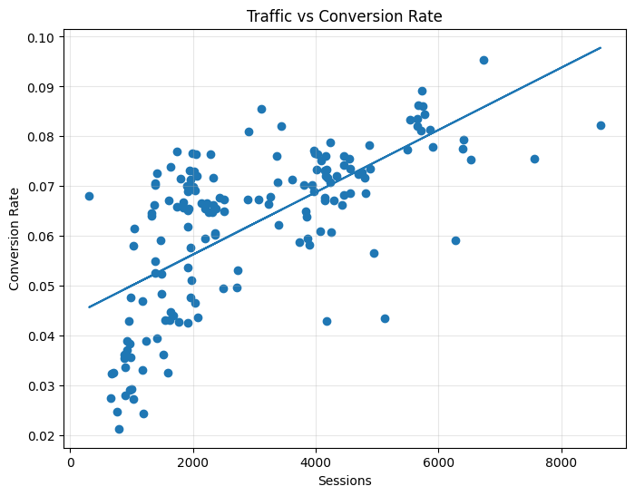

**R² = 0.4414**

This indicates a **moderate relationship between sessions and conversion rate**, though additional variables may influence this relationship.

---

## Business Pattern

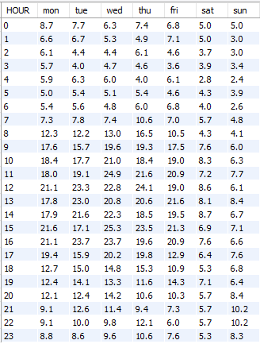

Traffic peaks between:

**9 AM – 5 PM on weekdays**

---

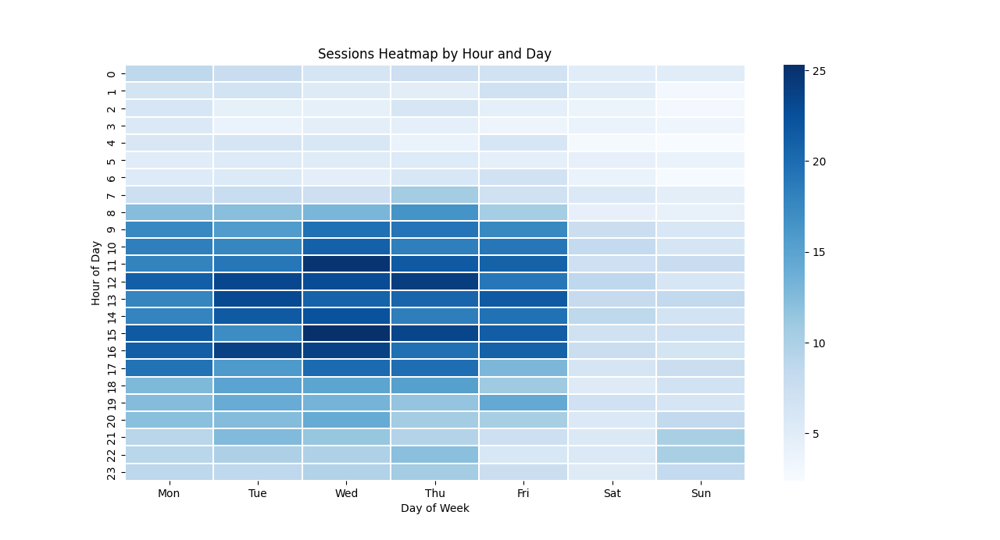

Heatmap of traffic distribution by **hour and weekday**.

---

# 5. Product-Level Analysis

## Product Sales

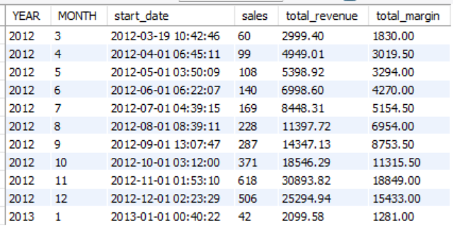

Revenue and margin are growing at an average **29.21% MoM**.

---

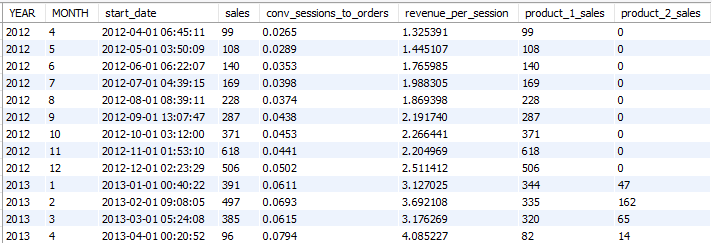

Although sales dipped slightly after launch, **revenue per session and conversion rate increased**.

---

## Product Launch Analysis

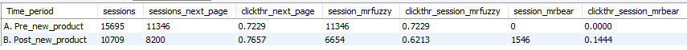

CTR for **mrfuzzy** decreased slightly after launching the new product.

---

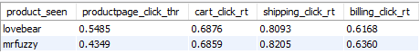

The new product **lovebear** performs well in funnel conversion.

---

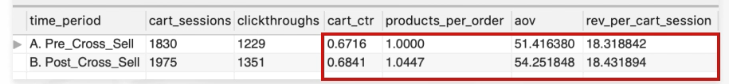

After adding **cross-selling at /cart**, both **AOV** and **revenue per cart session increased**.

---

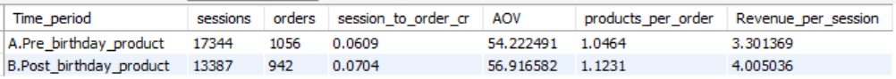

All key metrics improved after launching the third product.

---

## Product Return Analysis

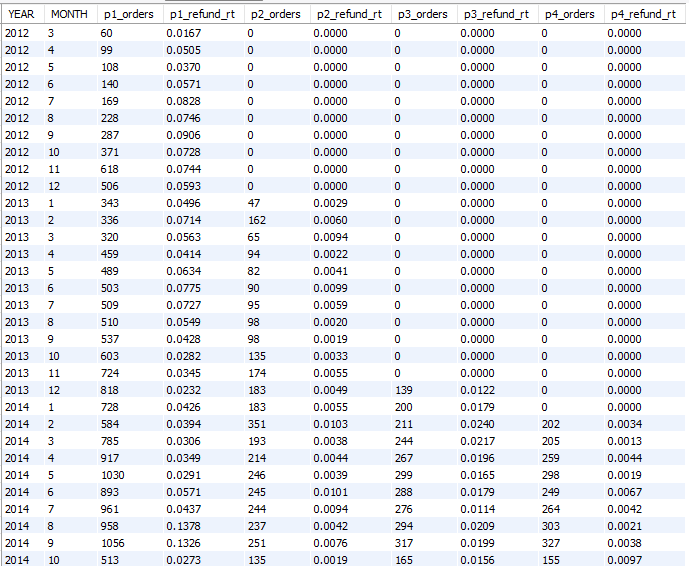

In **Aug–Sep 2014**, Product 1 experienced an unusual **~14% refund rate**.

After validation with the operations team, the issue was identified as a **product quality malfunction**.

---

# 6. User-Level Analysis

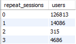

Total users: **145,900**

User distribution:

| Repeat sessions | Users | Share |
|---|---|---|
| 0 (no return) | 126,813 | 86.92% |
| 1 | 14,086 | 9.65% |
| 2 | 315 | 0.22% |
| 3 | 4,686 | 3.21% |

About **13% of new users come back** at least once within the period.

---

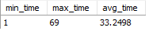

Time from a user's first session to their first repeat session:

- **Min:** 1 day
- **Max:** 69 days
- **Average:** 33.2 days

Users who return typically do so about **one month** after their first visit, which suggests a natural window for retention campaigns (e.g. email reminders around day 25–30).

---

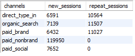

Most new sessions come from **paid_nonbrand**, indicating strong marketing performance.

Repeat sessions are dominated by:

- direct_type_in
- organic_search
- paid_brand

---

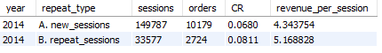

Returning users are more valuable than new users (2014):

| Session type | Conversion rate | Revenue per session |
|---|---|---|
| New | 6.80% | $4.34 |
| Repeat | **8.11%** | **$5.17** |

Repeat sessions convert **1.31 percentage points higher** and generate **~19% more revenue per session**, and they arrive mostly through low-cost channels (direct, organic, paid brand). This supports investing in retention alongside paid acquisition.
---

# Business Questions and Answers

## Q1
Monthly Gsearch sessions and orders  
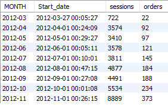

## Q2
Brand vs Non-brand performance  
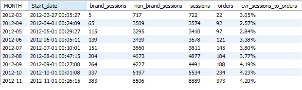

## Q3
Device-level performance  
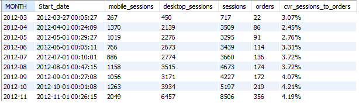

## Q4
Channel diversification  
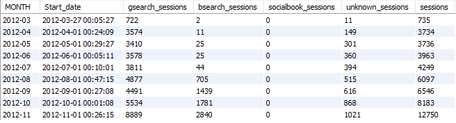

## Q5
Conversion rate improvement  
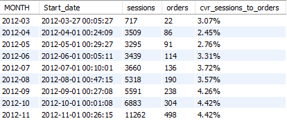

## Q6
Landing page experiment revenue impact  
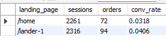

## Q7
Conversion funnel experiment  
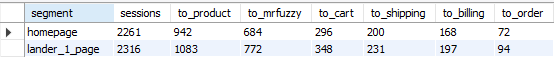

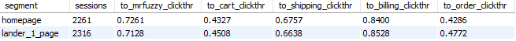

## Q8
Billing page experiment impact  
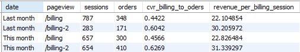

## Q9
Quarterly growth trend  
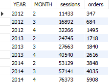

## Q10
Efficiency metrics  
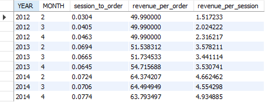

## Q11
Channel growth  
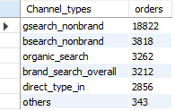

## Q12
Channel conversion rate trend  
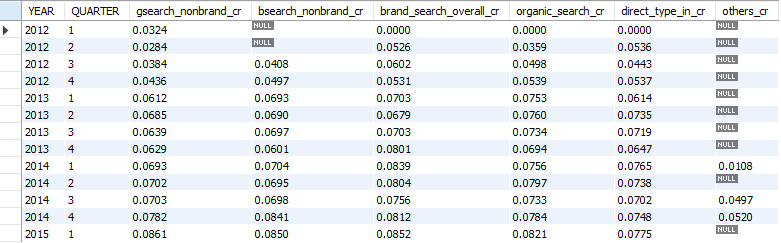

## Q13
Product revenue trends  
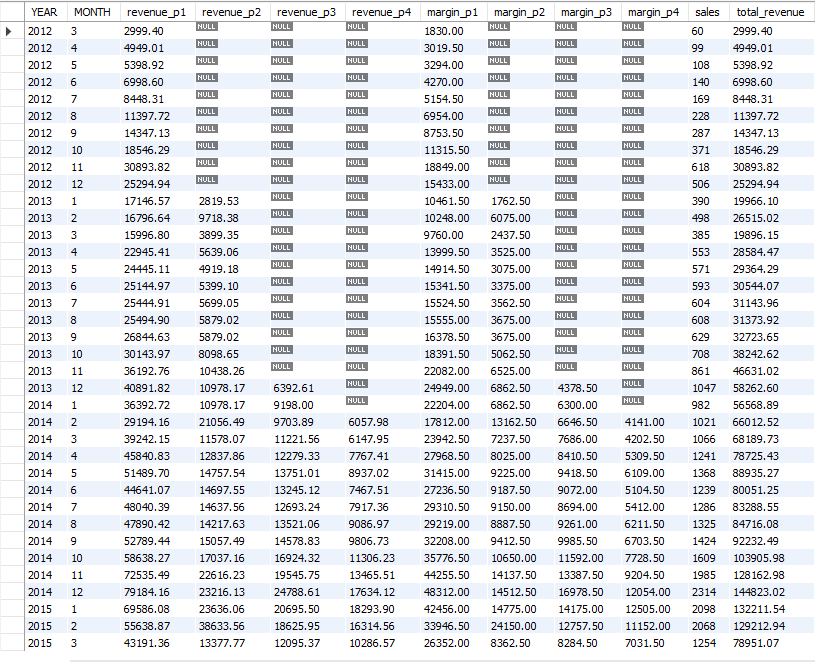

## Q14
Product page performance  
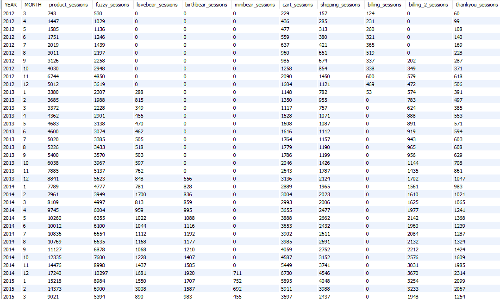

## Q15
Cross-sell performance  

---

# Skills Demonstrated

SQL  
Data Analysis  
Funnel Analysis  
A/B Testing Analysis  
Marketing Analytics  
Product Analytics  
Business Intelligence  

---

# Author

Lê Chí Hoàng Triều  
